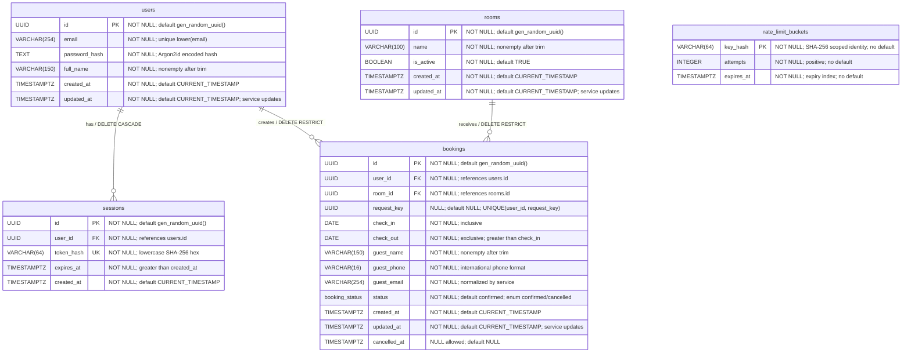

# Database Schema

PostgreSQL 17.6 · Schema `public` · Business timezone `Asia/Bangkok`

Migrations: [001 — business tables](../database/migrations/001_initial.sql), [002 — rate limits](../database/migrations/002_rate_limit_buckets.sql), [003 — booking request key](../database/migrations/003_booking_request_key.sql)  
Setup: [Database README](../database/README.md) · ผลตรวจ: [งาน 02](TESTING.md), [งาน 06](TESTING.md)

## ER Diagram



มี 4 business tables และ 1 infrastructure table โดย rate_limit_buckets ไม่มี foreign key

- User หนึ่งบัญชีมีหลาย sessions/bookings
- Booking แต่ละรายการมี user และ room อย่างละหนึ่ง
- ลบ user แล้ว sessions ถูกลบตาม แต่ลบ user/room ที่มี bookings ไม่ได้

## Data Dictionary

ทุกคอลัมน์ NOT NULL ยกเว้น bookings.cancelled_at และ bookings.request_key ค่า `—` หมายถึงไม่มี default ทุก business table ใช้ UUID primary key

### users

| Column | PostgreSQL type | Default | Constraint / ความหมาย |
|---|---|---|---|
| id | UUID | gen_random_uuid() | PK |
| email | VARCHAR(254) | — | Unique index บน lower(email) |
| password_hash | TEXT | — | Encoded Argon2id hash |
| full_name | VARCHAR(150) | — | ไม่ว่างหลัง trim |
| created_at | TIMESTAMPTZ | CURRENT_TIMESTAMP | เวลาสร้างบัญชี |
| updated_at | TIMESTAMPTZ | CURRENT_TIMESTAMP | Service อัปเดตเมื่อแก้ข้อมูล |

### sessions

| Column | PostgreSQL type | Default | Constraint / ความหมาย |
|---|---|---|---|
| id | UUID | gen_random_uuid() | PK |
| user_id | UUID | — | FK users.id; ON DELETE CASCADE |
| token_hash | VARCHAR(64) | — | Unique; lowercase SHA-256 hex 64 ตัว |
| expires_at | TIMESTAMPTZ | — | ต้องมากกว่า created_at |
| created_at | TIMESTAMPTZ | CURRENT_TIMESTAMP | เวลาสร้าง session |

Token มาจากข้อมูลสุ่ม 32 bytes ส่งให้ browser ผ่าน cookie ฐานข้อมูลเก็บเฉพาะ hash Session อายุคงที่ 7 วัน และใช้ไม่ได้เมื่อ now >= expires_at

### rooms

| Column | PostgreSQL type | Default | Constraint / ความหมาย |
|---|---|---|---|
| id | UUID | gen_random_uuid() | PK |
| name | VARCHAR(100) | — | ไม่ว่างหลัง trim; ไม่บังคับ unique |
| is_active | BOOLEAN | TRUE | เปิดรับจองใหม่ |
| created_at | TIMESTAMPTZ | CURRENT_TIMESTAMP | เวลาสร้าง |
| updated_at | TIMESTAMPTZ | CURRENT_TIMESTAMP | Service อัปเดตเมื่อแก้ข้อมูล |

การปิดห้องไม่ยกเลิก booking เดิม

### bookings

| Column | PostgreSQL type | Default | Constraint / ความหมาย |
|---|---|---|---|
| id | UUID | gen_random_uuid() | PK |
| user_id | UUID | — | FK users.id; ON DELETE RESTRICT |
| room_id | UUID | — | FK rooms.id; ON DELETE RESTRICT |
| check_in | DATE | — | รวมวันเริ่ม |
| check_out | DATE | — | ไม่รวมวันสิ้นสุด; ต้องมากกว่า check_in |
| guest_name | VARCHAR(150) | — | ไม่ว่างหลัง trim |
| guest_phone | VARCHAR(16) | — | รูปแบบสากล เช่น +66812345678 |
| guest_email | VARCHAR(254) | — | อีเมลผู้เข้าพัก |
| status | booking_status | confirmed | ENUM confirmed, cancelled |
| created_at | TIMESTAMPTZ | CURRENT_TIMESTAMP | เวลาสร้างรายการ |
| updated_at | TIMESTAMPTZ | CURRENT_TIMESTAMP | Service อัปเดตเมื่อแก้ข้อมูล |
| cancelled_at | TIMESTAMPTZ | NULL | Nullable; มีค่าเฉพาะ cancelled |
| request_key | UUID | NULL | Nullable สำหรับ legacy requests; UNIQUE ร่วมกับ user_id |

Guest fields เป็นข้อมูล ณ เวลาจอง แยกจากเจ้าของบัญชี `nights` คำนวณจาก check_out - check_in ไม่เก็บซ้ำ ปัจจุบัน API สร้างได้เฉพาะ confirmed; cancelled เตรียมไว้ใน schema

### rate_limit_buckets

| Column | PostgreSQL type | Default | Constraint / ความหมาย |
|---|---|---|---|
| key_hash | VARCHAR(64) | — | PK; lowercase SHA-256 hex 64 ตัว |
| attempts | INTEGER | — | CHECK > 0 |
| expires_at | TIMESTAMPTZ | — | เวลา reset quota |

ไม่มี FK Key เป็น hash ของ scope และ identity ไม่เก็บ email/IP/user ID ดิบ Atomic upsert นับ attempts สูงสุด max+1 และ reset เมื่อ expires_at <= now

## Constraints

| Name | กฎ |
|---|---|
| users_email_lower_uidx | อีเมลไม่ซ้ำโดยไม่สนตัวพิมพ์เล็กใหญ่ |
| users_name_nonempty | ชื่อบัญชีไม่ว่างหลัง btrim |
| sessions_token_hash_unique | Session hash ไม่ซ้ำ |
| session_hash_valid | Hash ตรง ^[0-9a-f]{64}$ |
| session_expiry_valid | expires_at > created_at |
| rooms_name_nonempty | ชื่อห้องไม่ว่างหลัง btrim |
| valid_booking_dates | check_out > check_in |
| guest_name_nonempty | ชื่อผู้เข้าพักไม่ว่างหลัง btrim |
| guest_phone_valid | เบอร์โทรตรง ^\+[1-9][0-9]{1,14}$ |
| cancellation_consistent | confirmed + cancelled_at NULL หรือ cancelled + timestamp |
| bookings_user_request_key_unique | คู่ user_id + request_key ไม่ซ้ำ; NULL ได้หลายรายการ |
| prevent_overlapping_bookings | confirmed ห้องเดียวกันห้ามช่วงวันทับ |
| rate_limit_key_valid | Bucket hash ตรง ^[0-9a-f]{64}$ |
| rate_limit_attempts_positive | attempts > 0 |

Exclusion constraint ใช้ extension btree_gist:

```sql
EXCLUDE USING gist (
    room_id WITH =,
    daterange(check_in, check_out, '[)') WITH &&
) WHERE (status = 'confirmed')
```

ตัวอย่าง: booking 10–12 ขวาง 11–13 แต่ไม่ขวาง 12–14 และไม่ขวางช่วงเดียวกันในห้องอื่น

## Indexes

| Index | ประเภท / ใช้กับ |
|---|---|
| *_pkey | Unique B-tree ของ primary keys |
| users_email_lower_uidx | Expression unique; register/login |
| sessions_token_hash_unique | Unique; session lookup |
| sessions_user_id_idx | B-tree; ค้น session ของ user/cascade |
| sessions_expires_at_idx | B-tree; cleanup |
| prevent_overlapping_bookings | Partial GiST; overlap/constraint |
| bookings_user_created_idx | Composite B-tree (user_id, created_at DESC, id DESC) |
| rate_limit_expiry_idx | B-tree; cleanup |

bookings_user_created_idx เตรียมรองรับการค้นประวัติผู้ใช้ ยังไม่มี API ประวัติในรอบแรก PK/unique/exclusion สร้าง indexes ให้แล้ว ไม่สร้างซ้ำ

## Validation Boundaries

| กฎ | Service | Database |
|---|---|---|
| Required/type/unknown fields | Strict schema | NOT NULL และ native types |
| Trim/lowercase/email format | ตรวจและ normalize | VARCHAR และ unique lower(email) |
| ชื่อ/โทรศัพท์ | ตรวจหลัง trim | Length และ CHECK |
| Password | ตรวจ 12–128 code points และ hash | เก็บ TEXT |
| วันนี้/จำนวนคืน/advance limit | Clock และ config | ไม่ใช้ dynamic CHECK |
| Checkout หลัง check-in | ตรวจเพื่อ field error | CHECK |
| ห้อง active และ user ownership | Session + row lock | FK ยืนยันรายการมีอยู่ |
| วันไม่ทับ | คืน error ที่เข้าใจได้ | Exclusion constraint รับประกัน |
| Session หมดอายุ | ตรวจทุก request | CHECK เฉพาะ expiry > creation |

String lengths นับ Unicode code points Service ตรวจ whitespace ตามกฎ input; SQL btrim เป็นการป้องกันพื้นฐาน

## Queries และ Transactions

Calendar ใช้ room ID, confirmed และ overlap:

```sql
WHERE room_id = $1::uuid
  AND status = 'confirmed'
  AND daterange(check_in, check_out, '[)')
      && daterange($2::date, $3::date, '[)')
ORDER BY check_in ASC
```

Equivalent: check_in < to AND check_out > from คืนวันจริงด้วย to_char(DATE, 'YYYY-MM-DD') ไม่ SELECT guest fields ดู [repository](../src/calendar/repository.ts)

Booking ใช้ READ COMMITTED บน client เดียว:

1. Authenticate และ validate ก่อนเปิด transaction
2. หากมี request_key: ตรวจผลที่ commit แล้วก่อนกฎวันที่; ถ้าไม่พบ BEGIN และ lock คู่ user/key ด้วย pg_advisory_xact_lock(hashtextextended(...)) แล้วอ่านผลซ้ำ ผลเดิมต้องมี payload ตรงกันจึง replay ได้
3. SELECT ห้อง FOR SHARE
4. ตรวจห้องมีอยู่และ active
5. INSERT โดย unique user/key และ exclusion constraint ตรวจช่วงวัน
6. COMMIT ก่อนคืน 201
7. Error ต้อง ROLLBACK; rollback ล้มเหลวให้ destroy connection

FOR SHARE ให้หลาย booking อ่านห้องร่วมกัน แต่ขวางการ UPDATE ปิดห้อง คำขอช่วงชนอาจรอ transaction แรก: commit แล้ว conflict, rollback แล้วจองได้ ไม่รับประกัน FIFO ตามเวลา HTTP มาถึง

Source: [Booking repository](../src/booking/repository.ts)

### Error Mapping

| Database error | API |
|---|---|
| 23505 + users_email_lower_uidx | 409 EMAIL_ALREADY_EXISTS |
| 23P01 + prevent_overlapping_bookings | 409 BOOKING_CONFLICT |
| Error อื่น | Rollback และ generic handler |

ตรวจ SQLSTATE และ constraint name ไม่ parse ข้อความ error หรือส่ง SQL กลับ client

## เวลาและ Maintenance

- วันพักเก็บ DATE และส่ง YYYY-MM-DD
- เวลาระบบเก็บ TIMESTAMPTZ และ serialize UTC
- today คำนวณ Asia/Bangkok ไม่อิง timezone เครื่อง
- updated_at อัปเดตโดย service ไม่มี trigger
- CURRENT_TIMESTAMP เป็นเวลาเริ่ม transaction ไม่ใช่หลักฐานลำดับ HTTP
- Cleanup expired sessions/buckets ทุก 60 วินาที; expiry check ไม่ขึ้นกับ cleanup

## Migration และ Seed

Apply 001 → 002 → 003 → seed สำหรับ DB ใหม่ ส่วน DB เดิมให้ apply เฉพาะ migration ที่ค้าง 003 เพิ่ม nullable UUID และ unique constraint โดยไม่แก้ booking เดิม ห้ามแก้ migration ที่ใช้ไปแล้วเพื่ออัปเกรด

Seed ห้องตัวอย่าง 5 ห้อง: บ้านพักหลัก, ห้องสวน, ห้องระเบียง, ห้องแสงเช้า และห้องมุมสงบ UUID ตามลำดับคือ 7c71298a-ef46-457c-ab5e-9edb238a54e5 ถึง 7c71298a-ef46-457c-ab5e-9edb238a54e9 ใช้ ON CONFLICT(id) DO NOTHING ไม่เพิ่มห้องซ้ำหรือเปิด inactive room กลับเอง ไม่มี seed users/passwords/bookings

Migration role ต้อง provision btree_gist ได้ Runtime-role provisioning และ production ledger/checksum/locking เป็นงาน production ที่ยังไม่ได้จัดทำ

## การตรวจ

- DB-only: migrations, seed, constraints, rollback, delete behavior และ lock state
- Backend integration: API responses, clock/config rules, shared counters และ concurrency
- Concurrency ใช้หลาย connections และ barrier/lock assertions ไม่อาศัยการเดาเวลา
- Tests ใช้ฐานข้อมูล disposable แยกจากข้อมูลใช้งาน

คำสั่งและผลจริง: [งาน 02](TESTING.md), [งาน 05](TESTING.md), [งาน 06](TESTING.md)
